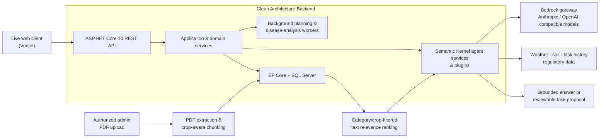

# GreenMind — AI-Powered Agricultural Decision Support

> A production-minded GenAI backend that helps farm operators plan export-ready crop operations with grounded regulatory knowledge, LLM-assisted workflows, and human-controlled execution.

[Explore the live demo](https://green-mind-silk.vercel.app) · [Run the API locally](#quick-start) · [Explore the API in Swagger](#quick-start)

GreenMind is a deployed agricultural decision-support product for export-oriented farms. We built it to turn fragmented operational, environmental, and regulatory information into safer, actionable planning workflows—without allowing an LLM response to directly alter farm operations.

## Why GreenMind

Export farming depends on decisions that are both time-sensitive and compliance-sensitive: crop schedules, soil conditions, weather forecasts, pesticide restrictions, quality standards, and disease observations all matter. GreenMind brings those inputs together in a secure backend that can:

- Generate and validate short-horizon farm-task plans from export-plan, soil, weather, and historical-task context.
- Ground LLM responses in curated EU compliance and crop-quality documents.
- Provide Arabic-first, context-aware farm and export-plan conversations.
- Analyse disease images and turn supported treatment recommendations into reviewable task proposals.
- Keep operational changes under explicit farm-owner review and approval.

## Architecture



## AI Systems

### Retrieval-Augmented Generation (RAG)

GreenMind uses a curated compliance knowledge base to ground agricultural and export guidance in source material rather than relying on model recall alone.

- Platform administrators ingest approved PDF standards and EU regulatory documents through protected endpoints.
- The backend extracts text, applies document-type-specific and crop-aware chunking, and persists each chunk with its category, source, and section reference.
- Retrieval pre-filters by relevant crop, destination, and compliance category, then returns the highest-ranked matching chunks to the LLM.
- Responses can surface their source and section reference, while an empty result is handled as missing knowledge—not as permission to invent a rule.

The current retrieval implementation deliberately uses deterministic text relevance ranking over the SQL-backed knowledge store. It is RAG, but it does **not** claim active semantic/vector search or a vector database.

### LLM Agents and Guardrails

Semantic Kernel organizes GreenMind's agent capabilities into focused plugins for weather, soil measurements, task history, regulatory data, and compliance retrieval.

- A planning workflow combines export-plan data, farm location, soil measurements, historic tasks, live weather, configured task types, and compliance context to generate a seven-day task plan.
- Structured LLM output is parsed, normalized, constrained to the planning window, and validated before persistence.
- Farm and export-plan chat receives only server-built, authorized context; prompts restrict the assistant to agricultural scope and require it to acknowledge uncertainty.
- AI-generated operational changes become expiring task-change proposals. Farm owners can review, edit, approve, or reject them before anything is applied.
- AI usage is recorded and governed with per-user limits, giving administrators visibility into model and feature consumption.

### Multimodal and Conversational AI

- Arabic-first contextual conversations support farm-level and export-plan-level decision making.
- The chat API uses an event-based response lifecycle, persists messages safely, protects idempotent retries, and summarizes older conversation history to preserve useful context.
- Vision-capable model calls support plant-disease image analysis; any resulting treatment plan remains a proposal for human review.

## Backend Engineering

The API is designed as a maintainable, secure, and reliable software service—not a thin LLM wrapper.

| Area | Implementation |
| --- | --- |
| Architecture | Clean separation across API, Application, Domain, and Infrastructure projects |
| API & data | ASP.NET Core 10 REST API, EF Core, SQL Server, OpenAPI/Swagger |
| Security | JWT authentication, role-based authorization, scoped farm-account access, private-file controllers, PDF signature/size validation |
| Reliability | Background workers, SQL connection retry handling, global exception handling, output validation, idempotent chat retries |
| Observability | Serilog request/application logging persisted to SQL Server; AI usage records and administrator reporting |
| Delivery controls | Rate limiting for AI and private-file endpoints, secrets kept outside source control, automated unit and integration tests |

## Product Workflows

- **Export-plan intelligence:** coordinate-based climate analysis, feasibility signals, signed analysis tokens, and weather-aware planning.
- **Compliance-aware operations:** quality, phytosanitary, pesticide-residue, and disease-treatment knowledge can be retrieved before responding or planning.
- **Farm operations:** farms, crops, destinations, soil measurements, schedules, task history, budgets, expenses, and dashboards are managed through the API.
- **Human-in-the-loop automation:** generated plans and suggested task changes support operators; they do not bypass approval or ownership checks.

## Technology Stack

- **Backend:** C#, .NET 10, ASP.NET Core, Entity Framework Core
- **AI orchestration:** Microsoft Semantic Kernel, Anthropic and OpenAI-compatible models via a Bedrock gateway
- **Knowledge ingestion:** PdfPig, custom document chunkers, SQL-backed compliance knowledge store
- **Data & infrastructure:** SQL Server, ASP.NET Core Identity, JWT, Serilog, SignalR, hosted background services
- **External data:** WeatherAPI and NASA POWER climate data
- **Quality:** xUnit-based unit and integration test projects

## Repository Layout

```text
Greenmind.Api/             HTTP API, middleware, controllers, hosted services
Greenmind.Application/     Use cases, contracts, DTOs, and application services
Greenmind.Domain/          Entities, business rules, and shared constants
Greenmind.Infrastructure/  Persistence, AI/RAG, external integrations, and workers
```

## Quick Start

### Prerequisites

- .NET 10 SDK
- SQL Server LocalDB (the default development connection uses `(localdb)\\MSSQLLocalDB`)
- EF Core CLI 10: `dotnet tool install --global dotnet-ef --version 10.*`
- A [WeatherAPI](https://www.weatherapi.com/) key
- An ITI Student Bedrock Gateway API key

### Configure and run

Run the following from the repository root. Keep all API keys and passwords in user secrets or environment variables—never commit them.

```powershell
dotnet restore
dotnet dev-certs https --trust
dotnet user-secrets set --project Greenmind.Api "Jwt:Key" "replace-with-a-random-secret-at-least-32-characters-long"
dotnet user-secrets set --project Greenmind.Api "ScheduleAnalysis:SigningKey" "replace-with-an-independent-random-secret-at-least-32-characters-long"
dotnet user-secrets set --project Greenmind.Api "Weather:BaseUrl" "https://api.weatherapi.com/v1/"
dotnet user-secrets set --project Greenmind.Api "Weather:ApiKey" "YOUR_WEATHER_API_KEY"
dotnet user-secrets set --project Greenmind.Api "iti:ApiKey" "YOUR_SBG_API_KEY"
dotnet ef database update --project Greenmind.Infrastructure --startup-project Greenmind.Api
dotnet run --project Greenmind.Api --launch-profile https
```

Alternatively, set the gateway key as `SBG_API_KEY`. Gmail SMTP settings are required only when testing email notifications.

The API runs at `https://localhost:7132`; Swagger is available at `https://localhost:7132/swagger`.

For local development, startup seeds an administrator account:

- Email: `admin@local`
- Password: `ChangeMe!P@ssw0rd`

This development-only credential must be replaced before deployment.

## Test

```powershell
dotnet test Greenmind.Application.Tests/Greenmind.Application.Tests.csproj
dotnet test Greenmind.Api.Tests/Greenmind.Api.Tests.csproj
```
